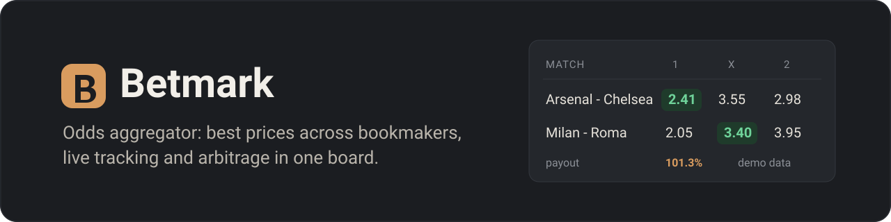
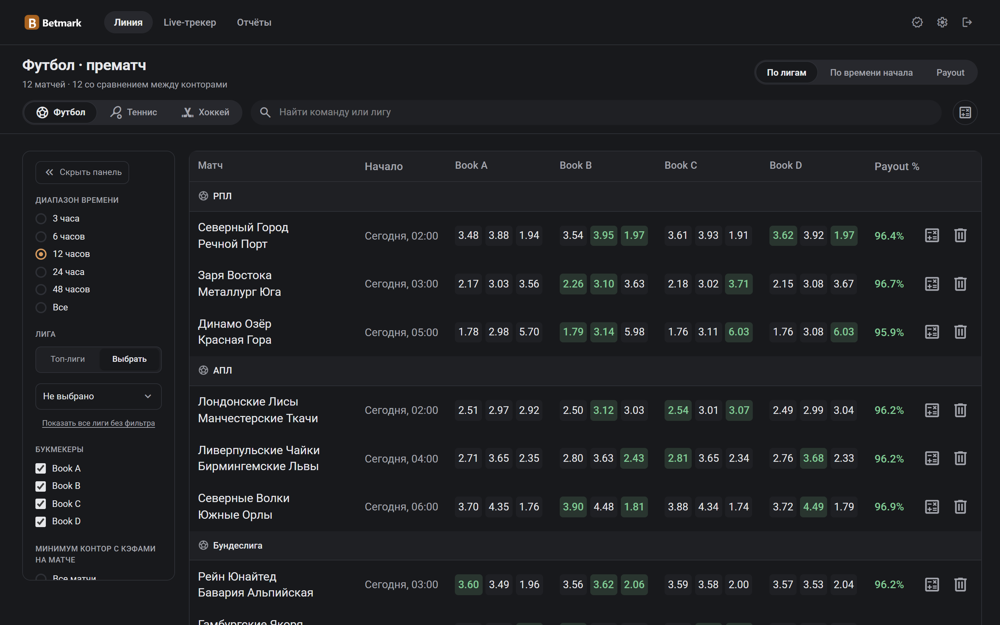
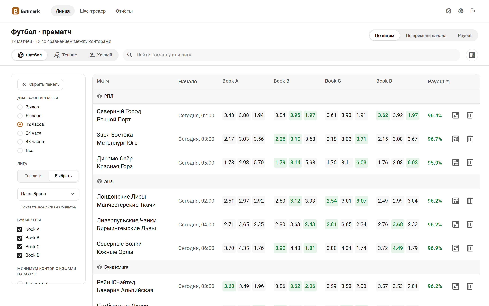
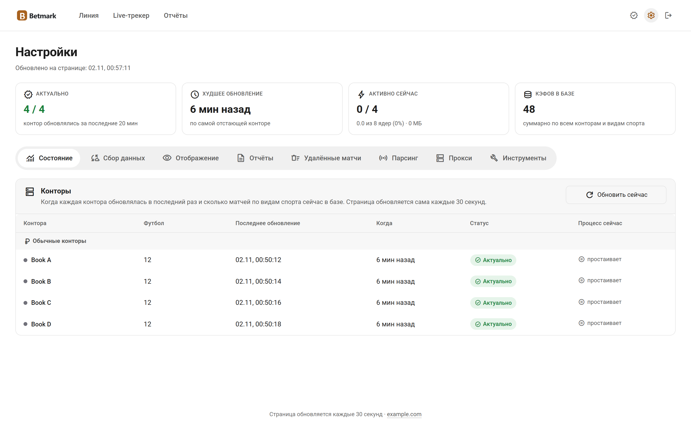
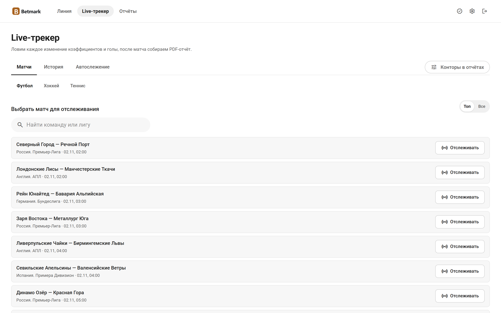
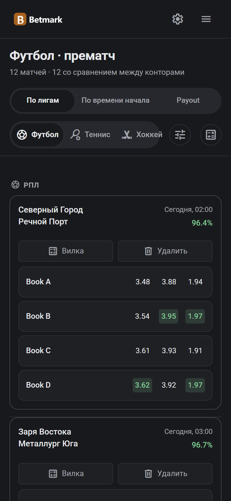

<p align="center">
  
</p>

<p align="center">
  <b>Self-hosted odds aggregator.</b> See the best price for every outcome across bookmakers in one table,<br>
  track matches live and catch arbitrage before it disappears.
</p>

<p align="center">
  
  
  
  
  
</p>

<p align="center">
  <a href="#quick-start">Quick start</a> ·
  <a href="#features">Features</a> ·
  <a href="#screenshots">Screenshots</a> ·
  <a href="docs/CONNECTORS.md">Add a bookmaker</a> ·
  <a href="README.ru.md">Русский</a>
</p>

<p align="center">
  
</p>

> This is a template. It ships with four demo bookmakers (Book A-D) and made-up matches, so the site works the moment you
> start it. Real scrapers are not included: you plug in your own sources through a small connector interface.

## Quick start

You need Node.js 20+ and PostgreSQL 15+ (running in UTC).

```bash
git clone https://github.com/lamine67/betmark-template.git && cd betmark-template
cp .env.example .env          # set DATABASE_URL, SESSION_SECRET, ADMIN_USER, ADMIN_PASSWORD
npm ci
npx prisma db push
npx tsx sync-booka.ts && npx tsx sync-bookb.ts && npx tsx sync-bookc.ts && npx tsx sync-bookd.ts
npm run dev
```

Open http://localhost:3000 and sign in with `ADMIN_USER`. Without HTTPS set `COOKIE_SECURE=false`, otherwise the browser
drops the login cookie.

## Features

- **Best-price board.** Matches grouped by league or by kick-off time, the top price in every column, payout per match,
  filters by league and bookmaker. On a phone the table turns into cards.
- **Match merging.** The same match from different bookmakers is joined by fuzzy team-name matching and a time window, with
  protection against swapped home and away teams.
- **Sanity checks.** Each new price is compared with the other bookmakers, so an obvious scraper mistake never reaches the board.
- **Live tracker.** Pick a match, follow every price change and goal on a chart, get a PDF report when it ends.
- **Arbitrage.** Scanner and calculator for surebets.
- **Status page.** Freshness of every source, polling intervals, one switch per collector.
- **Accounts.** Permissions, personal settings, installable as an app on a phone.
- **Optional LLM helpers.** Duplicate merging, anomaly checks and name translation through any OpenAI-compatible API.

## Screenshots

<table>
  <tr>
    <td width="50%"></td>
    <td width="50%"></td>
  </tr>
  <tr>
    <td></td>
    <td></td>
  </tr>
</table>

<p align="center"></p>

## Add your own bookmaker

1. Write a connector that returns matches as `NormalizedMatch` (`lib/collectors/types.ts`).
2. Copy `sync-booka.ts` to `sync-<slug>.ts` and plug your connector in.
3. Register the bookmaker in `lib/syncRunner.ts` and `lib/prematchBooks.ts` and enable it in `sync-config.json`.

The full guide with examples is in [docs/CONNECTORS.md](docs/CONNECTORS.md). Respect the terms of the sites you work with and
do not try to get around their bot protection.

## Configuration

All variables are described in [.env.example](.env.example). Sports, bookmakers and polling intervals live in
`sync-config.json` and can also be changed on the Status page.

The LLM helpers are enabled with `AI_BASE_URL`, `AI_API_KEY` and `AI_MODEL`. Without them everything else works as usual.
Live-tracker PDF reports need Python 3 with `reportlab` (`pip install reportlab`).

## Project layout

```text
app/                pages (board, live, arbitrage, status) and API routes
components/         UI
lib/                match merging, price checks, freshness, permissions
lib/collectors/     demo connector and stubs
prisma/             database schema
sync-*.ts           one collector per bookmaker
live-tracker-poll.ts, forks-scanner.ts, ai-dedup.ts   background workers
*.sh                schedulers for Linux (systemd + flock)
```

## Production

`npm run build && npm start` behind a reverse proxy with HTTPS. Collectors and workers are meant for Linux with systemd and
`flock`. Keep the database in UTC and back it up with `pg_dump`.

```bash
npx tsc --noEmit        # type check
npx prisma validate     # schema check
```

## License

No license has been chosen yet, so all rights are reserved for now.
