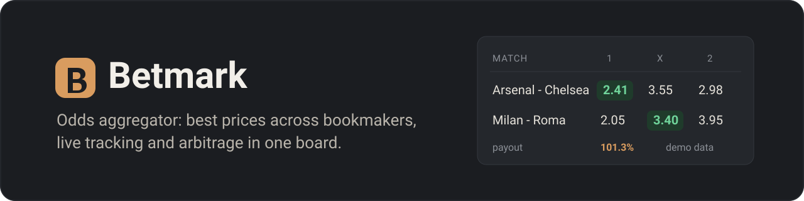
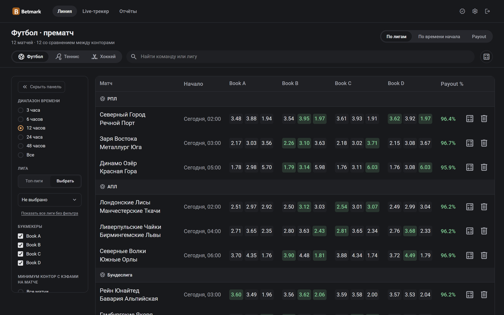
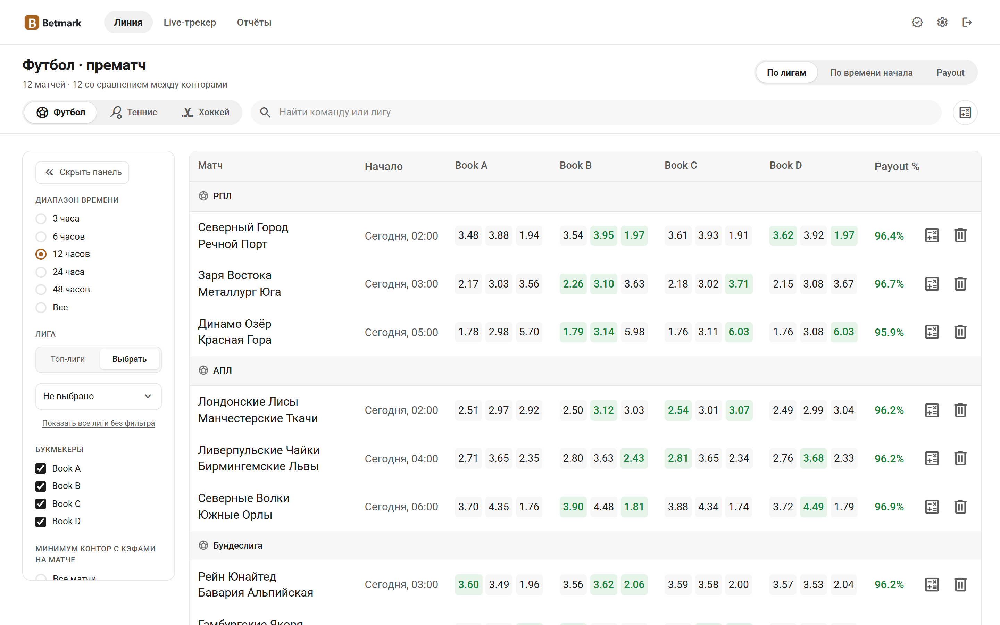
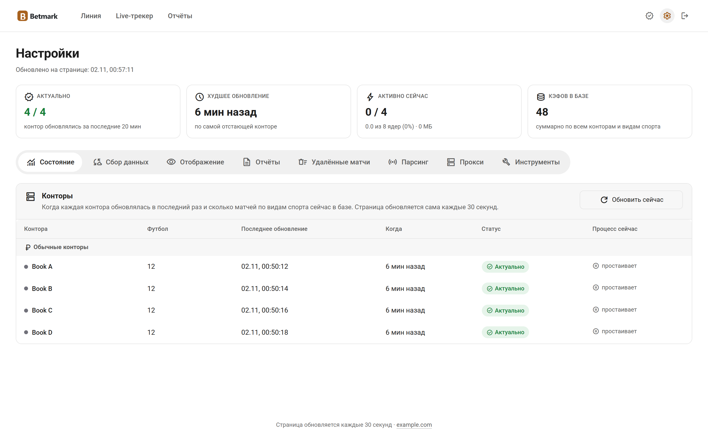
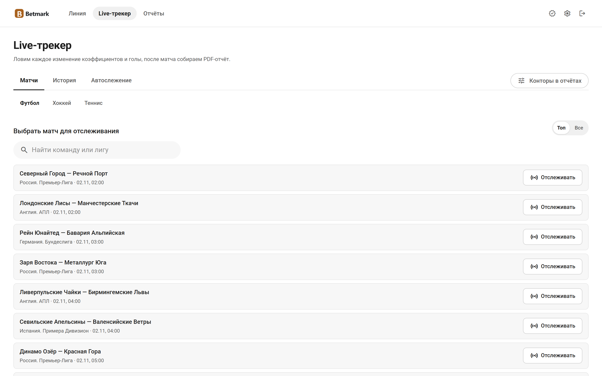
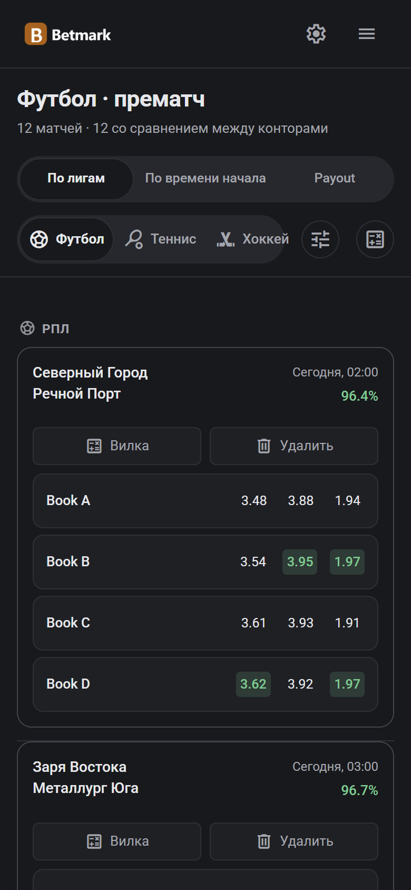

<p align="center">
  
</p>

<p align="center">
  <b>Агрегатор букмекерских коэффициентов на своём сервере.</b> Лучшая цена на каждый исход по всем конторам в одной таблице,<br>
  live-слежение за матчами и вилки, пока они не исчезли.
</p>

<p align="center">
  
  
  
  
  
</p>

<p align="center">
  <a href="#быстрый-старт">Быстрый старт</a> ·
  <a href="#возможности">Возможности</a> ·
  <a href="#скриншоты">Скриншоты</a> ·
  <a href="docs/CONNECTORS.md">Своя контора</a> ·
  <a href="README.md">English</a>
</p>

<p align="center">
  
</p>

> Это шаблон. В нём четыре демо-конторы (Book A-D) с вымышленными матчами, так что сайт работает сразу после запуска.
> Настоящих парсеров нет: свои источники подключаются через небольшой интерфейс коннектора.

## Быстрый старт

Нужны Node.js 20+ и PostgreSQL 15+ (база в часовом поясе UTC).

```bash
git clone https://github.com/lamine67/betmark-template.git && cd betmark-template
cp .env.example .env          # DATABASE_URL, SESSION_SECRET, ADMIN_USER, ADMIN_PASSWORD
npm ci
npx prisma db push
npx tsx sync-booka.ts && npx tsx sync-bookb.ts && npx tsx sync-bookc.ts && npx tsx sync-bookd.ts
npm run dev
```

Откройте http://localhost:3000 и войдите под `ADMIN_USER`. Без HTTPS поставьте `COOKIE_SECURE=false`, иначе браузер
не сохранит cookie входа.

## Возможности

- **Доска лучших цен.** Матчи по лигам или по времени, лучший кэф в каждой колонке, payout, фильтры по лигам и конторам.
  На телефоне таблица превращается в карточки.
- **Склейка матчей.** Один матч из разных контор сводится по нечёткому сравнению названий и окну по времени, с защитой
  от перепутанных хозяев и гостей.
- **Проверка цен.** Новая цена сверяется с другими конторами, явная ошибка парсера на доску не попадёт.
- **Live-трекер.** Каждое изменение кэфа и голы на графике, PDF-отчёт после матча.
- **Вилки.** Сканер и калькулятор.
- **Страница статуса.** Свежесть каждого источника, интервалы опроса, включение и выключение сборщиков.
- **Аккаунты.** Права, личные настройки, установка на телефон как приложение.
- **Помощники на языковой модели (необязательно).** Склейка дублей, проверка аномалий, перевод названий через любой
  OpenAI-совместимый API.

## Скриншоты

<table>
  <tr>
    <td width="50%"></td>
    <td width="50%"></td>
  </tr>
  <tr>
    <td></td>
    <td></td>
  </tr>
</table>

<p align="center"></p>

## Своя контора

1. Коннектор возвращает матчи в формате `NormalizedMatch` из `lib/collectors/types.ts`.
2. Скопируйте `sync-booka.ts` в `sync-<slug>.ts` и подставьте свой коннектор.
3. Добавьте контору в `lib/syncRunner.ts` и `lib/prematchBooks.ts` и включите её в `sync-config.json`.

Подробно и с примерами: [docs/CONNECTORS.md](docs/CONNECTORS.md). Соблюдайте правила сайтов, с которыми работаете,
и не обходите их защиту от ботов.

## Настройки

Все переменные с пояснениями в [.env.example](.env.example). Виды спорта, конторы и интервалы опроса задаются в
`sync-config.json` или на странице «Статус».

Языковая модель подключается переменными `AI_BASE_URL`, `AI_API_KEY`, `AI_MODEL`, без них всё остальное работает как обычно.
Для PDF-отчётов live-трекера нужен Python 3 с `reportlab` (`pip install reportlab`).

## Структура

```text
app/                страницы (доска, live, вилки, статус) и API
components/         интерфейс
lib/                склейка матчей, проверки цен, свежесть, права
lib/collectors/     демо-коннектор и заглушки
prisma/             схема базы
sync-*.ts           сборщик на каждую контору
live-tracker-poll.ts, forks-scanner.ts, ai-dedup.ts   фоновые службы
*.sh                запуск по расписанию на Linux (systemd + flock)
```

## Продакшен

`npm run build && npm start` за обратным прокси с HTTPS. Сборщики и службы рассчитаны на Linux с systemd и `flock`.
Базу держите в UTC и бэкапьте через `pg_dump`.

```bash
npx tsc --noEmit        # типы
npx prisma validate     # схема базы
```

## Лицензия

Лицензия пока не выбрана, поэтому все права защищены.
